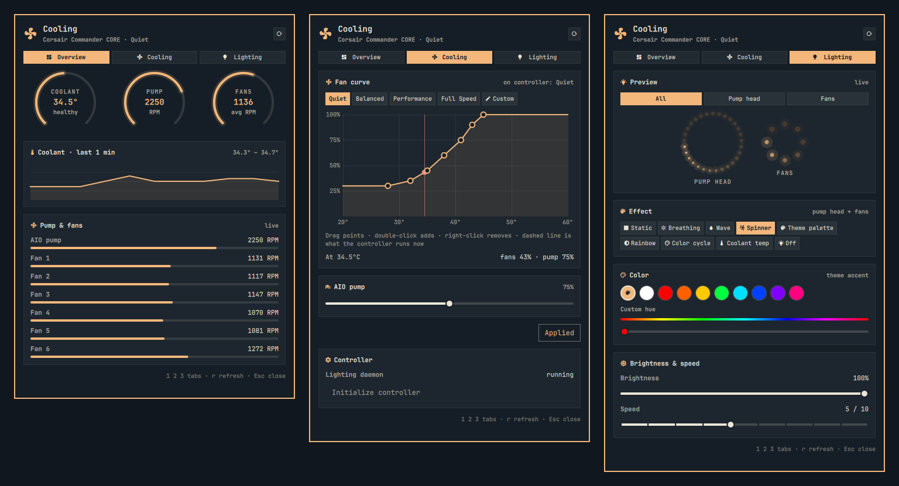

# Corsair Cooling for Omarchy

Omarchy bar widget for Corsair Commander CORE fan and AIO control.



- On-demand coolant, pump and six-fan telemetry through `liquidctl`
- Quiet, Balanced, Performance and Full Speed profiles
- Two-step confirmation before every control write
- No automatic profile application at startup

Profiles use coolant-temperature curves stored on the controller. `Full Speed`
sets all fans and the AIO pump to 100%. The upstream driver labels Commander CORE
support as broken/experimental, so monitor the first application of each profile.

The helper only accepts fixed action and profile names; arbitrary commands and
custom speed values are rejected.

## Install

Install `liquidctl` first:

```bash
sudo pacman -S liquidctl
```

If that conflicts with `python-hid` required by QMK, keep QMK intact and use an
isolated install:

```bash
pipx install liquidctl
```

Linux also needs liquidctl's official
[`71-liquidctl.rules`](https://github.com/liquidctl/liquidctl/blob/main/extra/linux/71-liquidctl.rules)
for unprivileged device access. Distribution packages normally install it. For
a `pipx` install, copy the version-matched rule to `/etc/udev/rules.d/`, reload
udev, and trigger both USB and hidraw devices.

Then install the widget:

```bash
omarchy plugin add https://github.com/matteodevenuto/omarchy-corsair-cooling.git --enable
```

## Safety

- Telemetry refresh is manual because every Commander CORE status request can
  flash its RGB. Press `r` in the panel or middle-click the bar widget to read it.
- No profile is applied automatically at startup.
- Every profile write requires selecting a profile and confirming it.
- USB requests are serialized because Omarchy creates one widget per monitor
  and Commander CORE uses a stateful protocol.
- Presets never stop the pump or fans and reach 100% fan duty at high coolant
  temperatures.

The liquidctl driver currently labels Commander CORE support as
`broken`/experimental. Watch coolant temperature and RPM during the first use
of each profile.

## Known limitation: RGB flashes during device access

Commander CORE can briefly leave hardware-lighting mode whenever `liquidctl`
reads status or writes a profile. This is an upstream device/driver limitation,
not an RGB effect produced by this plugin. It is tracked in
[`liquidctl` issue #448](https://github.com/liquidctl/liquidctl/issues/448), and
the protocol documents that sleep returns the controller to hardware mode:
[`commander_core.md`](https://github.com/liquidctl/liquidctl/blob/main/docs/developer/protocol/commander_core.md#wake-upsleep).

To prevent repeated flashing, version 1.0.1 performs no automatic refreshes.
Status is read only after pressing `r`, middle-clicking the widget, or invoking
its refresh IPC method. A single flash can still occur for each explicit read
or profile change.

## Profiles

- **Quiet** — 75% pump; gradual fan curve reaching 100% at 45°C coolant.
- **Balanced** — 85% pump; reaches 100% at 43°C.
- **Performance** — 100% pump; reaches 100% at 40°C.
- **Full Speed** — pump and all six fans at 100%.

## Remove

```bash
omarchy plugin remove matteodevenuto.corsair-cooling
```

Removing the widget does not reset a curve already stored on the controller.
Apply the desired profile before removal or power-cycle the controller.
